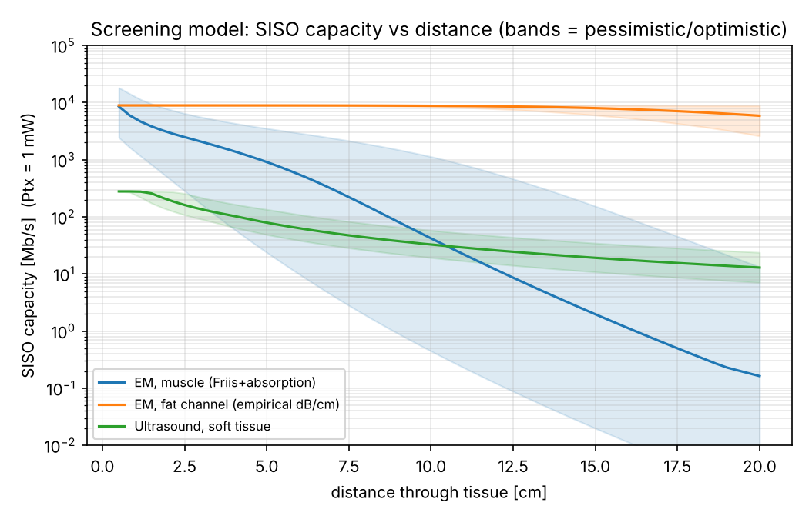
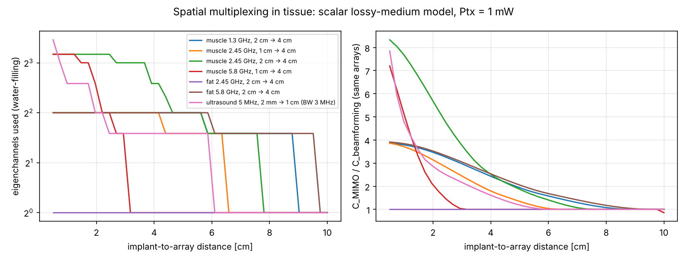

# body_channel

Research on **high-data-rate EM communication through the human body**, using
spatial (and polarisation) orthogonality with MIMO. The goal is a
demonstrator built from commercial SDRs plus custom PCBs.

## Documents

| | |
|---|---|
| [docs/01_landscape.md](docs/01_landscape.md) | prior work: HBC, Fat-IBC, ultrasound, implant MIMO; tissue constants |
| [docs/02_critique.md](docs/02_critique.md) | **critique, likely reviewer objections, rebuttals and suggestions** |
| [docs/03_research_plan.md](docs/03_research_plan.md) | hypotheses, work packages, methods, metrics, risks, timeline |
| [docs/04_hardware_and_demo.md](docs/04_hardware_and_demo.md) | demo architecture, equipment tiers, custom PCB specs, phantoms |

## Main findings from the screening models

Assumptions: 1 mW Tx, 6 dB NF, 30 dB implementation SNR cap, −20 dB implant
antenna efficiency. These are first-order models, meant for planning only.

1. **EM through muscle beats ultrasound only up to ~10 cm.** It gives
   ~0.9 Gb/s at 5 cm vs ~80 Mb/s for ultrasound, but loses beyond ~10–12 cm.
   The EM result swings 100× with implant antenna efficiency and size.
2. **Spatial multiplexing works at short range.** With a 2 cm implant array
   and a 4 cm skin array at 2.45 GHz in muscle, the gain over beamforming on
   the same arrays is 7.7× at 1 cm, 1.9× at 5 cm and 1× at 8 cm.
3. **The fat channel has high SNR but almost no spatial DoF at 2.45 GHz**
   (λ_tissue ≈ 5.3 cm). Use 5.8 GHz or polarisation to get multiple streams.
4. **The novelty gap:** we found no published measured, real-time,
   spatially multiplexed through-tissue EM link with absolute link budgets.




## Running the models

```bash
pip install -r requirements.txt
cd sim
python tissue.py                         # Gabriel 1996 tissue model + self-check
python link_budget.py --plot ../docs/figures/siso_capacity_vs_distance.png
python mimo_dof.py   --plot ../docs/figures/mimo_streams_vs_distance.png
```

All assumptions are in the `Assumptions` (`link_budget.py`) and `Link`
(`mimo_dof.py`) dataclasses. Fit them to measured data as soon as it exists.
