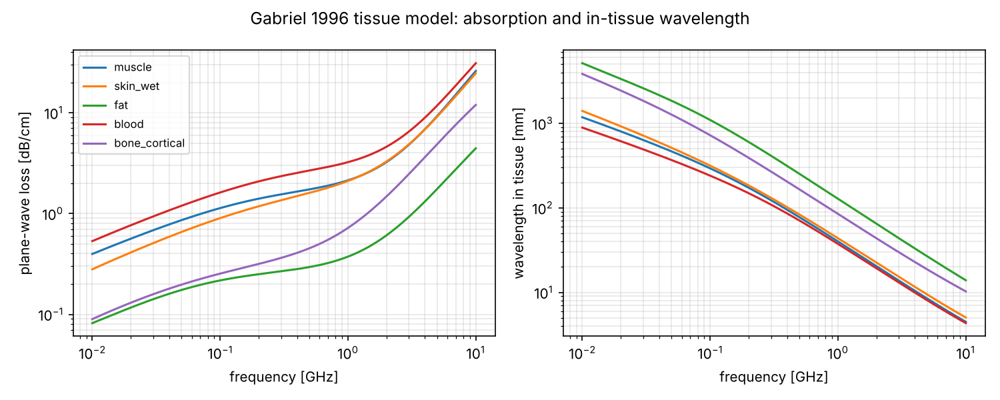

# Landscape: communicating through the body

Status: literature scan done in October 2026 from web search only (no full-text
access in this environment). **Verify every number against the original papers
before citing.**

## Modalities at a glance

| Modality | Carrier | Reported data rate | Range / medium | Notes |
|---|---|---|---|---|
| Capacitive HBC (IEEE 802.15.6 HBC PHY) | 21 MHz | 164 kb/s – 1.3 Mb/s | along body | standardised, low rate |
| Electro-quasistatic HBC (Purdue, S. Sen) | ≤ 30 MHz | ≤ 20–30 Mb/s (6.3 pJ/b transceiver) | along body, ~60–70 dB path loss | commercial **Wi-R** (Ixana): YR11 up to 1 Mb/s, YR21 announced at 20 Mb/s |
| Body-Resonance HBC (Sen group, arXiv 2411.10905) | near/intermediate field, above EQS | projected 100s of Mb/s (~30× EQS capacity) | wearable-to-wearable | transmission-line-like body mode; mostly modelling so far |
| Galvanic coupling | kHz – MHz | kb/s – low Mb/s | short | electrodes |
| MedRadio implants | 401–406 MHz | ~100s kb/s (typical ICs) | implant → external | EIRP ≤ 25 µW |
| **Fat-IBC** (Uppsala, R. Augustine) | 1.7–2.6 GHz, 5.8 GHz | **up to 120 Mb/s in phantoms** (2026 thesis) | in-body / on-body via fat layer | ~0.7 dB/cm phantom, ~1.9 dB/cm ex vivo (Sensors 2018); 802.15.4 packet tests ~96 % PRR |
| Ultrasound (UIUC: Singer, Oelze, et al.) | ~1–10 MHz | **up to 30 Mb/s through 5 cm** pork loin / beef liver, plus in vivo (IEEE TBME 2021) | through tissue | MEAT-COMMS 2016: 20–30 Mb/s ex vivo |
| Ultrasound, mm-scale crystals | ~1.2 MHz | 3.2–6.7 Mb/s (water, beef liver, pork, in situ rabbit) | through tissue | 2 mm transducers, IEEE TUFFC 2020 |
| Ultrasound, spatial DoF | MHz | multi-stream | implant links | arXiv 1702.05154. **Spatial multiplexing has already been explored for ultrasound** |
| Implant MIMO antennas (various) | 433 MHz – 2.45 GHz | e.g. 19.9 b/s/Hz (4-element, simulated, at normalised SNR) | antenna-level | capacity numbers from simulation or fixed-SNR normalisation; not real links |

## Gaps we can fill

1. **Measured through-tissue EM MIMO channel matrices** (H(f) across depth,
   frequency and tissue type) with absolute link budgets. We found none.
2. **Real-time, spatially multiplexed EM link through tissue**, compared on
   equal terms (power, SAR, size) against SISO and beamforming.
3. **Rank-vs-depth laws for tissue**: where spatial multiplexing collapses into
   beamforming, as a function of frequency and aperture.
4. **Orthogonality beyond space:** polarisation and guided-mode multiplexing in
   the skin/fat/muscle stack.
5. **Multi-implant MU-MIMO** for distributed neural interfaces.

## Physical constants that drive everything

From the Gabriel 1996 Cole–Cole model ([`sim/tissue.py`](../sim/tissue.py),
validated to 0.5 % against tabulated values):

| Tissue | f | ε′ | σ [S/m] | λ in tissue | 1/e depth | Plane-wave loss |
|---|---|---|---|---|---|---|
| Muscle | 403 MHz | 57.1 | 0.80 | 94 mm | 52 mm | 1.65 dB/cm |
| Muscle | 915 MHz | 55.0 | 0.95 | 44 mm | 42 mm | 2.06 dB/cm |
| Muscle | 2.45 GHz | 52.7 | 1.74 | 16.7 mm | 22 mm | 3.89 dB/cm |
| Muscle | 5.8 GHz | 48.5 | 4.96 | 7.3 mm | 7.5 mm | 11.5 dB/cm |
| Fat | 2.45 GHz | 5.3 | 0.10 | 53 mm | 117 mm | 0.74 dB/cm |
| Fat | 5.8 GHz | 5.0 | 0.29 | 23 mm | 40 mm | 2.15 dB/cm |
| Skin (wet) | 2.45 GHz | 42.9 | 1.59 | 18.5 mm | 22 mm | 3.94 dB/cm |
| Blood | 2.45 GHz | 58.3 | 2.54 | 15.8 mm | 16 mm | 5.39 dB/cm |

Ultrasound in soft tissue: c ≈ 1540 m/s (λ = 0.31 mm at 5 MHz), and
attenuation is ≈ 0.5–1 dB/cm/MHz.

## Key references

* S. Gabriel, R. W. Lau, C. Gabriel, "The dielectric properties of biological
  tissues III", *Phys. Med. Biol.* 41:2271 (1996).
* Uppsala Fat-IBC: "Characterization of the Fat Channel for Intra-Body
  Communication at R-Band Frequencies", *Sensors* 18(9):2752 (2018);
  "Data Packet Transmission Through Fat Tissue for Wireless IntraBody
  Networks", IEEE JERM (2017); J. Engstrand, "Fat-Intrabody Communication for
  Medical Implants and Brain–Computer Interfaces", PhD thesis, Uppsala (2026).
* Kou, Miller, Singer, Oelze, "High Data Rate Communications In Vivo Using
  Ultrasound", IEEE TBME (2021), doi:10.1109/TBME.2021.3070477.
* "Mbps Experimental Acoustic Through-Tissue Communications: MEAT-COMMS",
  arXiv:1603.05269.
* "Exploiting Spatial Degrees of Freedom for High Data Rate Ultrasound
  Communication with Implantable Devices", arXiv:1702.05154.
* "Video-Capable Ultrasonic Wireless Communications Through Biological
  Tissues", IEEE TUFFC (2020), doi:10.1109/TUFFC.2020.3020776.
* Santagati & Melodia, ultrasonic intra-body networking (U-Wear and related),
  Northeastern WINES lab.
* "Body-Resonance Human Body Communication", arXiv:2411.10905 (Sen group).
* A. S. Y. Poon, S. O'Driscoll, T. H. Meng, "Optimal frequency for wireless
  power transmission into dispersive tissue", IEEE TAP (2010).
* M. Lazebnik et al., "Tissue-mimicking phantom materials for narrowband and
  ultrawideband microwave applications", *Phys. Med. Biol.* (2005).
* Iqbal et al. (2021), quad-element 433 MHz implantable MIMO antenna (simulated
  capacity), Durham.
* Ghanem et al. (2012), on-body MIMO capacity at 2.45 GHz; Qaraqe et al.
  (2014), wrist–waist MIMO channel.

**Open item:** the "Cornell ultrasound body channel" paper. We couldn't
identify it. Please add the citation here.
