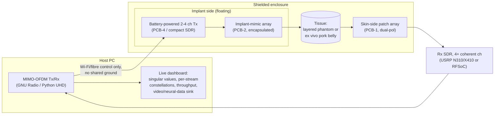

# Hardware, custom PCBs and demonstrator

Prices are rough mid-2020s list prices. **Verify part numbers, specs and prices
before ordering.**

## 1. Demonstrator architecture

**Demo storyline:**
1. SISO baseline through 3 cm of tissue.
2. Switch on 2×2 and then 4×4. Throughput rises, and the dashboard shows the
   streams separating.
3. Increase the depth. The singular values collapse, and rank adaptation drops
   to beamforming. This shows the physics honestly.
4. Put absorber over the air paths and move the cables. The link is unchanged,
   which proves the signal goes through tissue.
5. Compare against SISO and ultrasound numbers on the same slide.

## 2. Commercial equipment by tier

### Tier A: bring-up and SISO channel (≈ $1–2k)
| Item | Role | Notes |
|---|---|---|
| LibreVNA (2-port, 100 kHz–6 GHz) or NanoVNA V2 Plus4 (to 4.4 GHz) | S21 vs f and depth; dielectric probe | LibreVNA ~$500–700 |
| ADALM-Pluto | first OFDM link, 1×1 | ~$250; 2nd channel on Rev C/D via U.FL |
| SMA cables, ferrite chokes (snap-on, mix 61/43), SMA attenuators | artifact control | |
| Semi-rigid 0.141" coax, SMA panel jacks | DIY open-ended dielectric probe | |
| Phantom supplies: agar/gelatin, NaCl, sugar, PE powder, oil, Triton X-100 | phantoms | |
| Acrylic tanks, 3D-printed fixtures, stepper-driven linear stage | repeatable geometry | |

### Tier B: MIMO channel sounding and 2×2 real-time link (≈ $5–10k)
| Item | Role | Notes |
|---|---|---|
| 2× USRP B210 (70 MHz–6 GHz, 2×2, shared LO per board) | 2×2 MIMO Tx and Rx | ~$2–2.5k each; ~30 MHz/ch in 2×2 over USB 3 |
| or 2× bladeRF 2.0 micro xA4 (47 MHz–6 GHz, 2×2) | cheaper alternative | ~$500–600 each |
| or compact AD9361 SDR on battery (e.g. ANTSDR E200-class) | floating implant-side 2×2 Tx | removes cable/ground artifacts |
| OctoClock-G (10 MHz + PPS) | sync across boards on the Rx side | the Tx can stay unsynchronised (realistic; estimate the CFO) |
| USB RF switch matrices (e.g. Mini-Circuits USB-SP4T-63 / USB-1SP8T-63H) | VNA-based N×M sounding | or the custom PCB-3 |
| Shielded box or Faraday tent; RF absorber sheets | regulatory compliance and air-path control | |
| Fibre-optic temperature probe or thermocouples | heating checks | |

### Tier C: high-rate, 4×4+ (≈ $15–40k, or borrowed)
| Item | Role | Notes |
|---|---|---|
| USRP N310 (4 ch, 10 MHz–6 GHz, 100 MHz BW) | 4×4 MIMO receiver | |
| USRP X410 (4 ch, to 7.2 GHz, 400 MHz BW) | Gb/s-class demos at 5.8 GHz | |
| AMD RFSoC 4x2 (academic) | direct-RF sampling, very wide BW, FPGA DSP | ~$2k academic; check ADC/DAC counts and Nyquist zones for your band |
| Lab multiport VNA or Keysight/R&S 4-port | gold-standard H(f) | borrow if possible |
| Commercial RF-over-fibre link (to 6 GHz) | cable-free implant feed | ~$2–5k per link |
| Keysight N1501A / SPEAG DAK probe | reference dielectric data | borrow |

**Synchronisation:** the receiver channels must share an LO, or be
phase-calibrated (B210 and N310 share an LO within a board; across boards use
OctoClock plus phase calibration). The *implant-side* transmitter should use its
own clock, as a real implant would. Pilots and CFO/SFO estimation handle the
rest.

## 3. Custom PCBs

### PCB-1: skin-side tissue-coupled array
* 2×2 to 4×4 **dual-polarised** patch or slot elements at the chosen band(s).
  Pitch ≈ λ_tissue/2 in the near-skin medium.
* High-ε substrate (Rogers RO3010, εr≈10.2, or RO3006) and/or a thin
  matching superstrate. This cuts the impedance mismatch to skin (ε′≈40).
  Integrated baluns and U.FL/SMA ports.
* Flex (polyimide) variant for conformal wear later.
* Designed and verified in openEMS **with the layered tissue load**, not in
  air. Target ≥15 dB inter-element isolation.

### PCB-2: implant-mimic array
* 1–2 cm footprint: 2 dual-polarised elements, or 4 monopoles/loops/slots on
  thin Rogers or flex.
* **Encapsulation is part of the antenna.** Use PDMS/silicone (εr≈2.7),
  parylene-C, or a ceramic superstrate (alumina εr≈9.8, zirconia εr≈29;
  higher ε helps). Design with the encapsulation present.
* Coax exits with sleeve balun and chokes (v1), then direct connection to
  PCB-4 (v2).

### PCB-3: switch matrix and calibration board
* Turns a 2-port VNA into an N×M channel sounder. Use 2× SP8T absorptive
  switches (e.g. ADI ADRF5040-class SP4T in cascade, DC–6+ GHz; verify), MCU
  control over USB, and on-board through/short/open/load paths for
  de-embedding.
* Requirements: isolation ≥40 dB (so leakage stays well below the weakest
  tissue path), and switching ≤1 ms so a full H(f) completes inside the
  channel coherence time.

### PCB-4: floating implant-mimic transmitter
* v1: a commercial compact 2×2 SDR plus a battery pack in a small shielded
  can, controlled over Wi-Fi or fibre only (no galvanic connection to the
  receiver).
* v2 (custom): a 2–4 channel TX built around an IQ modulator plus a
  fractional-N PLL plus a small FPGA/MCU playing stored OFDM frames. Include a
  TCXO and a battery. Its job is to prove there's no cable path, not to be
  implant-sized.
* Optional power measurement header for honest energy-per-bit numbers on the
  Tx side.

### PCB-5 (optional): receiver front-end
* Band-pass filters for the ISM bands plus sub-1 dB NF LNAs per channel. SDR
  noise figures are ~5–8 dB, so 4–6 dB of NF directly buys SNR. Add a bias tee
  for remote mounting near PCB-1.

## 4. Software stack
* **Simulation:** Python (`sim/`), openEMS (FDTD; free; Python API), and
  optionally Sim4Life/CST/HFSS for SAR on anatomical models.
* **SDR:** UHD Python API and GNU Radio. MATLAB WLAN Toolbox is handy to
  generate and decode 802.11n/ac MIMO-OFDM reference waveforms. Use a custom
  Python OFDM for the research PHY (rank adaptation, SIC).
* **Data:** Touchstone `.sNp` files plus JSON metadata (tissue, temperature,
  depth, fixture ID, calibration file, controls applied).

## 5. Phantom recipes (starting points; tune with the probe)
* **Muscle (2–6 GHz):** deionised water, NaCl (~0.5–1 % w/w), sugar or
  polyethylene powder to lower ε, agar 2–3 % or gelatin. Target ε′≈50,
  σ≈1.7 S/m at 2.45 GHz.
* **Fat:** oil-in-gelatin emulsion (Lazebnik 2005), 70–90 % oil. Target
  ε′≈5, σ≈0.1 S/m at 2.45 GHz.
* **Skin:** like muscle, with slightly lower water content. ~1–2 mm sheets.
* **Layered stack:** skin (2 mm) / fat (5–30 mm, swappable) / muscle (≥5 cm).
  Fat thickness is a key experimental variable.
* Seal phantoms against dehydration and re-measure dielectric properties
  every session.

## 6. Safety and compliance checklist
- [ ] SAR simulation per antenna design, with a derived Tx power ceiling
- [ ] Temperature-rise test in phantom at max duty cycle
- [ ] Shielded enclosure for wideband experiments (or an experimental licence)
- [ ] Biosafety handling for ex vivo tissue
- [ ] IACUC (animal) and IRB (human, skin-side only) before any live work
